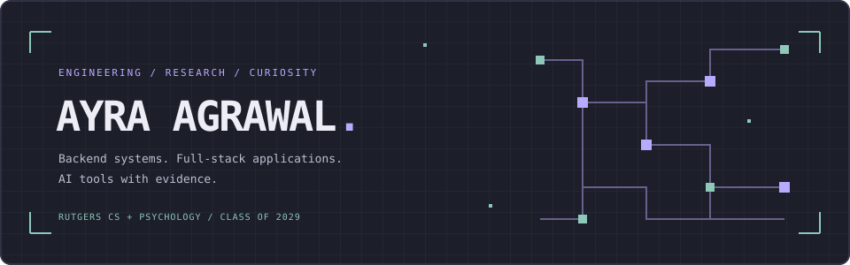

# Hi, I’m Ayra

  

  CS + Psychology @ <strong>Rutgers University–New Brunswick</strong> · Class of 2029 
  Backend &amp; Full-Stack Engineering · AI &amp; Research Software

  <a href="https://ayra-agrawal-portfolio.vercel.app/">Portfolio</a> &nbsp;·&nbsp;
  <a href="https://github.com/ayraagrawal-byte">GitHub</a> &nbsp;·&nbsp;
  <a href="https://www.linkedin.com/in/ayra-agrawal/">LinkedIn</a> &nbsp;·&nbsp;
  <a href="mailto:ayraagrawal@gmail.com">Email</a>

## About me

I like understanding what happens beneath an interface: how a request becomes a database write, how a search result becomes evidence, and how a measurement becomes trustworthy.

I’m studying computer science and psychology, with a Data Science minor and an expected graduation of May 2029. My work spans backend systems, full-stack applications, AI retrieval, and cognitive-science research software.

**Right now:**

- **Research Assistant & IT Team Member · CALC Lab / Rutgers Center for Cognitive Science** — R data-processing and validation pipelines, PsychoPy experiments, and eye-tracking systems.
- **Backend Developer · Hack4Impact, Rutgers** — Supabase systems and role-based functionality for Love Blue Inc.’s beach-cleanup tracking application.
- **Frontend Software Engineering Fellow · Rutgers Blueprint** — developing my frontend engineering practice.
- **Looking for Summer 2027 software engineering internships.**

## Technical toolkit

**Languages**

**Applications & data**

**AI / retrieval:** Ollama · Sentence Transformers · pgvector · BM25 · MediaPipe · Gemini API

**Infrastructure / testing:** Docker · AWS EC2 · Vercel · Git · GitHub Actions · Pytest · Vitest · Playwright

**Research systems:** R automation · PsychoPy · Tobii Pro · DeTox · behavioral data validation

## Selected projects

### [TraceLab](https://github.com/ayraagrawal-byte/tracelab)

**Backend systems & infrastructure** · API, worker, caching, and observability

A tracing backend that separates request ingestion from PostgreSQL persistence using a Redis queue and a background worker. Includes trace/span APIs, structured logging, Prometheus metrics, Docker Compose, and CI integration tests.

Built with `Python` · `FastAPI` · `PostgreSQL` · `Redis` · `Docker` · `AWS EC2`

The repository reports a local Docker / Locust test at 100 concurrent clients: approximately **500 req/s** steady-state ingestion, **96 ms p95** API latency, and **0% HTTP failures**. These are API enqueue results, not production traffic or database persistence throughput.

[Engineering case study](https://ayra-agrawal-portfolio.vercel.app/work/tracelab)

---

### [Recall](https://github.com/ayraagrawal-byte/recall)

**Full-stack AI engineering** · Research workspace & source-linked evidence

A workspace for ingesting PDFs, retrieving relevant passages, and inspecting the evidence behind an answer. Combines semantic and BM25 retrieval, query expansion, cross-encoder reranking, and local Ollama generation with a PDF evidence viewer.

Built with `Next.js` · `TypeScript` · `FastAPI` · `PostgreSQL / pgvector` · `Ollama`

The public frontend is a **controlled demo** with curated content and recorded execution. The complete RAG backend runs locally; the newer live workspace is on `recall-2.0`.

[Demo](https://recall-research-workspace-demo.vercel.app/) · [Inside Recall](https://recall-research-workspace-demo.vercel.app/inside-recall) · [Case study](https://ayra-agrawal-portfolio.vercel.app/work/recall)

---

### [SpotOn](https://github.com/shuknuk/hackru-fall-2026) · HackRU Fall 2026

**Collaborative development** · Three-person team

Co-developed a browser-based squat-analysis project with pose landmarks, joint-angle measurements, skeleton replay, and attempt comparison. The project uses local-first storage, optional Gemini feedback, and ElevenLabs voice guidance.

Built with `Next.js` · `MediaPipe` · `IndexedDB` · `Gemini` · `ElevenLabs` · `TimescaleDB`

The repository belongs to my teammate. Project capabilities are shared team work; physical-camera accuracy and device acceptance remain unverified.

[Demo](https://menhel-motion.vercel.app/)

---

### [RUThrift](https://github.com/ayraagrawal-byte/rumad-incubator-2026) · RUMAD Incubator

**Backend Developer** · Four-person team · February–May 2026

A Rutgers-exclusive marketplace application. My work focused on authentication, profiles, and backend integration, including email verification flows.

Built with `React Native` · `Expo` · `Supabase` · `PostgreSQL`

The public snapshot includes mock listing and chat flows; those screens do not establish a complete persisted messaging backend.

## Currently exploring

- Backend delivery guarantees, asynchronous processing, and useful observability.
- Retrieval systems that make their sources easy to inspect.
- Reliable behavioral-data pipelines and experiment technology.
- Summer 2027 software engineering opportunities.

---

Curious about the system. Careful with the details.

